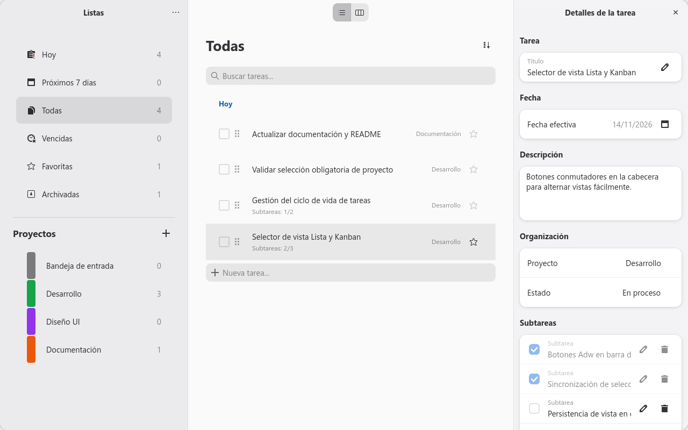
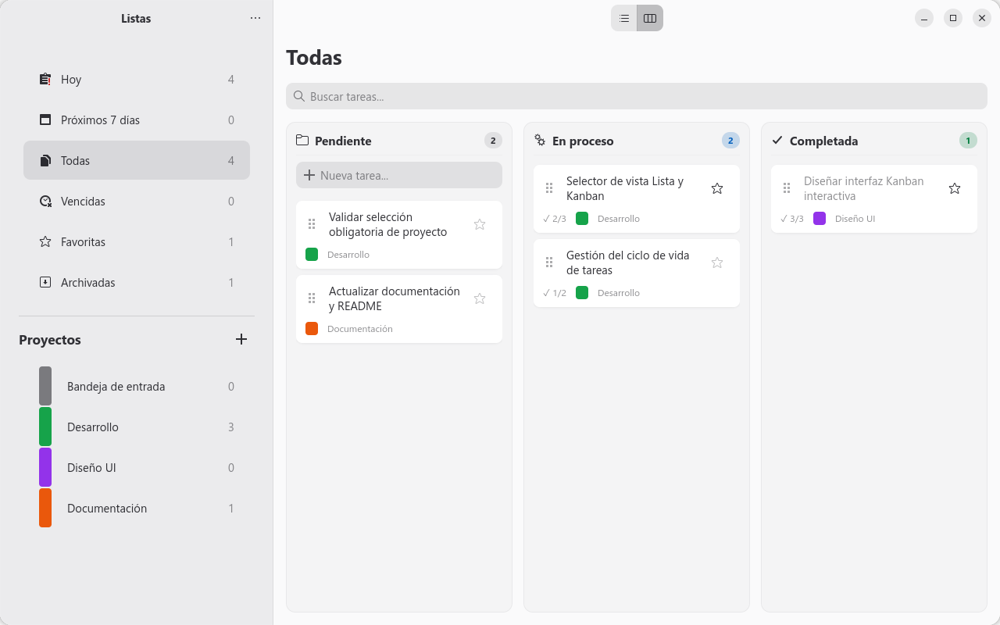

# Todo List

Task manager for GNOME built with Python, GTK 4 and libadwaita.





## Overview

Todo List is a desktop application focused on simple task and project management:

- **Dual View Modes**: Switch between a structured **List view** and an interactive **Kanban board** with toggle buttons in the header bar.
- **Interactive Kanban Board**: Visualize and manage tasks across three workflow columns (*Pending*, *In progress*, *Completed*) with drag-and-drop support.
- **Task Status Lifecycle**: Explicitly track task progress (`pending`, `in_progress`, `completed`) with a status selector in the detail panel or through Kanban column transitions.
- **Smart Lists**: Automatic filtering by *Today*, *Next 7 days*, *All*, *Overdue*, *Favorites*, and *Archived*.
- **Project Organization**: Organize tasks into custom color-coded projects, with enforced project assignment to prevent orphaned tasks.
- **Task Details & Subtasks**: Assign effective dates, notes, and favorite flags. Break complex tasks down with lightweight subtask checklists.
- **Drag & Drop Reordering**: Reorder tasks in list view and move cards between status columns in Kanban view.
- **Persistent Selection Highlighting**: Selected tasks remain highlighted across both views while the detail panel is open.
- **Search**: Fast, real-time search filtering tasks within the current list or board.
- **Import & Export**: Backup and restore data via standard JSON format through the file chooser portal.
- **GNOME HIG & Adwaita**: Native look and feel, responsive design with adaptive split view, light/dark/system theme support, and full keyboard shortcuts.
- **Multilingual**: Interface available in English and Spanish.

## Installation

### Flatpak (Recommended)

You can install Todo List directly from the personal Flatpak repository:

```bash
# Add the repository (one-time setup)
flatpak remote-add --user --if-not-exists --no-gpg-verify pabmartine-repo https://pabmartine.github.io/flatpak-repository/

# Install the application
flatpak install pabmartine-repo com.pabmartine.TodoList

# Run
flatpak run com.pabmartine.TodoList
```

Alternatively, download the standalone `.flatpak` bundle from the latest [GitHub Release](https://github.com/pabmartine/todo-list/releases/latest) and install it:

```bash
flatpak install --user com.pabmartine.TodoList.flatpak
```

## Run From Source

### Requirements

- Python 3.10+
- GTK 4
- libadwaita 1
- PyGObject

Examples:

```bash
sudo apt install python3 python3-gi python3-gi-cairo gir1.2-gtk-4.0 gir1.2-adw-1
```

## Run

From the project root:

```bash
python3 todo-list.py
```

Alternative entrypoint:

```bash
PYTHONPATH=src python3 -m todo_list.main
```

## Data And Config

The application stores its files in:

- `~/.config/todo-list/config.json`
- `~/.config/todo-list/tasks.json`

Stored settings include:

- Current language
- Style preference (follow system, light or dark)
- Window size
- Last selected list
- Last selected view mode (list or kanban)

## Project Layout

```text
src/todo_list/         Python package
  ├── core/            Constants, configuration, debug and i18n
  ├── models/          Task and Project data models
  ├── repositories/    Task persistence and schema migrations
  ├── services/        Task and Project domain logic
  └── ui/              GTK 4 and libadwaita views, kanban board, and dialogs
tests/                 Automated unit and migration tests
data/                  Desktop file, AppStream metainfo and icons
locale/                gettext catalogs and translation files
scripts/               Translation extraction and compilation helper scripts
packaging/flatpak/     Flatpak manifest and build scripts
docs/                  Functional and technical documentation
```

## Documentation

- [User Guide](docs/user-guide.md)
- [Architecture](docs/architecture.md)
- [Development](docs/development.md)
- [Packaging](docs/packaging.md)
- [Internationalization](docs/i18n.md)
- [Roadmap](docs/roadmap.md)
- [Contributing](CONTRIBUTING.md)

## Development Notes

Useful commands:

```bash
bash scripts/compile_translations.sh
bash scripts/extract_strings.sh
bash packaging/flatpak/build-flatpak.sh
PYTHONPATH=src python3 -m unittest discover -s tests -v
python3 -m py_compile todo-list.py src/todo_list/*.py src/todo_list/core/*.py src/todo_list/models/*.py src/todo_list/repositories/*.py src/todo_list/services/*.py src/todo_list/ui/*.py src/todo_list/ui/support/*.py
```

Validation combines `unittest`, `py_compile` and manual GTK checks for UI flows.

## License

GPL-3.0-only. See [LICENSE](LICENSE).
